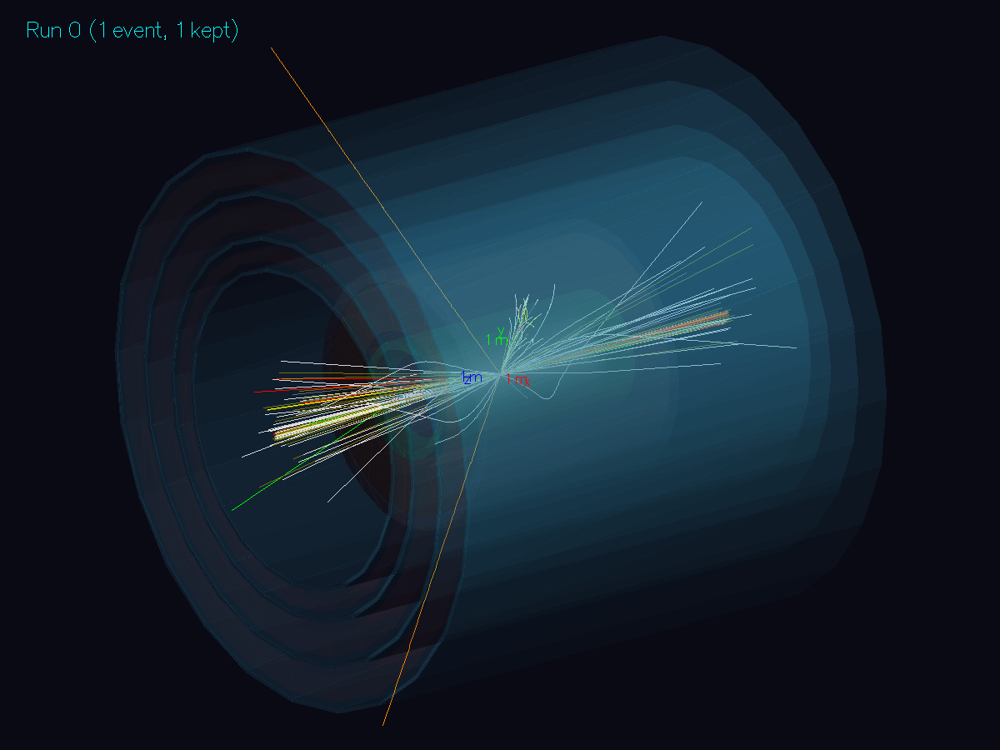
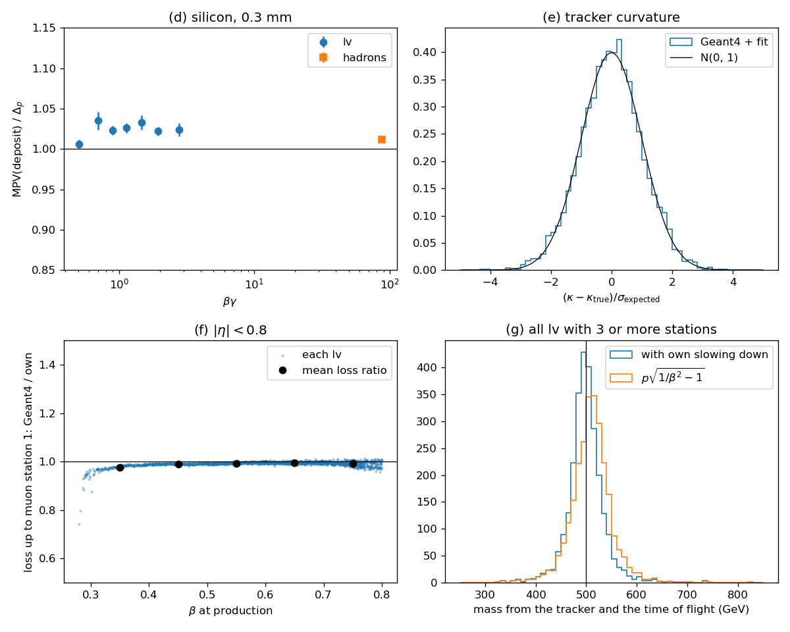

# 安定な重い荷電レプトン：FeynRules から Geant4 と Qt まで

模型のファイル（`.fr`）から始めて、事象の生成、パートンシャワー、検出器の模擬、Qt での表示までを一つの模型で通す。どの段も、独立な計算との数値の一致で確かめる。

## 模型

標準模型に、ベクトル的な荷電レプトン LV を一つ加える（[model/VLL.fr](model/VLL.fr)）。SU(2) の一重項で、超電荷は左右とも Y = −1（右巻きの電子と同じ量子数）、質量は MLV = 500 GeV、PDG 番号は 9000011（lv⁻）。

```
L_LV = LVbar (i γ^μ D_μ − MLV) LV,   D_μ = ∂_μ − i g1 Y B_μ
```

SM のレプトンとの湯川結合も混合もないので、LV は安定である。光子と Z を通じて対で作られ（pp → lv⁺lv⁻）、遅い（β ≈ 0.3–0.95）重い荷電粒子として検出器を突き抜ける。模型の粒子がそのまま検出器に入るので、Geant4 の側で新粒子を定義する段が流れに入る。

## 流れ

| 段 | 道具 | すること | ファイル |
|---|---|---|---|
| 1 | FeynRules 2.3.49 | VLL.fr を SM.fr に重ねて読み、頂点を照合して UFO を書く | [model/generate_vll.wl](model/generate_vll.wl) |
| 2 | MG5_aMC 3.8.1 | UFO から pp → lv⁺lv⁻（13 TeV、NNPDF4.0 NLO、μ_F = μ_R = √ŝ） | [run_workflow.sh](run_workflow.sh) |
| 3 | Pythia 8.317 | MG5 の `shower=Pythia8`：シャワー、ハドロン化、多重パートン相互作用。HepMC 2 に書く | 同上 |
| 4 | Geant4 11.4.3 | HepMC の安定粒子を簡略化した CMS 型の検出器に通し、ROOT の ntuple に書く | [detector/](detector/) |
| 5 | Geant4 の Qt（ToolsSG） | 1事象ずつ表示する | [run_view.sh](run_view.sh)、[detector/view.mac](detector/view.mac) |
| 6 | 自前の Python | 各段を独立な計算と照合する | [check_workflow.py](check_workflow.py) |

段のあいだで新粒子がどう渡るかは次のとおり。

- MG5 → Pythia：MG5 は param_card の `QNUMBERS` のブロック（スピン、電荷、色）を LHE の頭に書く。Pythia はこれを読んで lv± を作り、崩壊幅が 0 なので安定として扱う。
- Pythia → Geant4：HepMC の status 1 の粒子が Geant4 の一次粒子になる。lv± の粒子は [detector/Physics.cc](detector/Physics.cc) で定義する（スピン 1/2、電荷 ∓1、安定、質量は HepMC の値）。物質との相互作用は多重散乱と電離（`G4hIonisation`：陽子・反陽子の表を質量比で拡大する Bethe–Bloch）だけである。制動放射と電子対生成は 1/M² で効くので入れていない。
- Pythia には cτ < 10 mm の粒子だけを崩壊させる（`ParticleDecays:limitTau0`）。K⁰_S、Λ などは Geant4 が検出器の中で崩壊させる。

## 検出器

円筒の層だけからなる、CMS に似せた簡略な検出器である（[detector/Detector.cc](detector/Detector.cc)）。端蓋はない。

| 部分 | 物質 | 半径（mm） | \|z\|（mm） | 磁場 |
|---|---|---|---|---|
| ビーム管 | Be | 22.5–23.3 | < 3000 | 3.8 T |
| 飛跡検出器 | Si、厚さ 0.3 mm の 12 層 | 30, 70, 110, 160, 250, 340, 430, 520, 610, 750, 900, 1050 | < 2500 | 3.8 T |
| 電磁カロリメータ | PbWO₄（25.8 X₀） | 1290–1520 | < 3000 | 3.8 T |
| ハドロンカロリメータ | 真鍮 55 mm とプラスチックシンチレータ 4 mm の 20 組 | 1770–2950 | < 3000 | 3.8 T |
| コイル | Al | 3000–3300 | < 3000 | なし |
| ミューオン検出器 | Ar/CO₂（80/20）、厚さ 100 mm の 4 層 | 4000, 4800, 5930, 7060 | < 6500 | なし |
| ヨーク | Fe の 3 層 | 4300–4600, 5100–5730, 6230–6860 | < 6500 | −1.8 T |

物理リストは FTFP_BERT に lv± を加えたもの。lv± 以外の飛跡は時刻 500 ns で打ち切り（最も遅い lv± でも外側のミューオン層には約 170 ns で着く）、20000 段を超えた飛跡は記録して打ち切る（下の「気づいた点」）。バッチの実行は 4 スレッドで優先度を下げて行い、注目する一次粒子（lv±、および pT > 5 GeV の荷電粒子）の始点と終点、飛跡検出器とミューオン検出器を横切った点（位置、時刻、運動量、βγ、Si に落としたエネルギー）、事象ごとのカロリメータのエネルギーを書く（[detector/Actions.cc](detector/Actions.cc)）。

## 使い方

Geant4 を使うので、どのスクリプトも `~/hep/opt/geant4env.sh` を自分で読む。

```bash
simulation/stable_lepton/run_workflow.sh
```

全段を実行する（4000 事象、約 7 分。うち Geant4 が 4 スレッドで約 5 分）。`run_workflow.sh 1000` で事象数を変え、`--reuse` でできているもの（UFO、事象、Geant4 の出力）を使い回す。出力は `out/` に書かれ、git には入らない。

```bash
simulation/stable_lepton/run_view.sh
```

Qt の窓で事象を1つずつ表示する（引数で最初の事象の番号を指定できる）。lv± は橙、ミューオンは緑、電子は赤、光子は薄い黄、荷電ハドロンは白で、1 GeV より柔らかい飛跡は隠してある。窓の中では、ドラッグで回転、ホイールで拡大し、下の命令を打つ。

| 命令 | すること |
|---|---|
| `/run/beamOn 1` | 次の事象 |
| `/vlldet/event 17` のあと `/run/beamOn 1` | ファイルの 17 番の事象 |
| `/vis/viewer/set/viewpointVector 0 0 1` | ビーム軸から見る（r–φ） |
| `/vis/viewer/set/viewpointVector 1 0 0` | 横から見る |
| `/vis/filtering/trajectories/soft/active false` | 柔らかい飛跡も表示する |

Qt の出力欄には、事象ごとに lv± の運動量、β、飛跡の終わる位置、ミューオン検出器に着いた時刻が出る。`run_view.sh --check` は窓を開かずに、同じ視点の絵を `out/view/check.png` に描く（下の「気づいた点」）。



69 番の事象。橙の 2 本が lv⁺（β = 0.42、η = +0.28）と lv⁻（β = 0.62、η = +0.62）で、どちらも 4 層のミューオン検出器を抜ける。lv⁺ は 231.5 GeV で生まれ、外へ出るときには運動エネルギーが 36.6 GeV まで減っている。ビーム方向の束は underlying event である。

## 検算の結果

4000 事象（lv± は 8000 本）での結果。`out/check.log` に出る。どれも自前の計算との比較である。

| | 比べるもの | 結果 |
|---|---|---|
| 模型 | LV の γ・Z 頂点と、右巻き電子の頂点（FeynRules） | 一致 |
| (a) | σ(pp → lv⁺lv⁻)：MG5 と、自前の qq̄ → γ\*/Z\* → lv⁺lv⁻ の LHAPDF 積分 | 2.3530 ± 0.0053 fb と 2.3521 fb（差 +0.04%、0.2σ） |
| (b) | Pythia のあとの lv± | 4000 事象すべてに lv⁺ と lv⁻ が 1 個ずつ、質量 500.0000 GeV |
| (c) | Geant4 に渡った一次粒子と、HepMC の status 1 の粒子（ニュートリノを除く） | 4000 事象すべてで数が一致、lv の四元運動量の差は相対 1×10⁻¹⁵ |
| (d) | 厚さ 0.3 mm の Si に落ちたエネルギーの最確値と、Landau–Vavilov–Bichsel の Δ_p（PDG の式 34.12、Sternheimer の密度効果） | lv（βγ = 0.4–4）で 1.006–1.035 倍、βγ > 10 のハドロンで 1.012 倍 |
| (e) | 飛跡検出器の曲率（位置を rφ 20 μm、z 50 μm でぼかして放物線で当てはめる）と、自前の誤差（測定点と、Highland の多重散乱を層ごとに相関させたもの） | pull の平均 −0.006 ± 0.014、中央 68% の半幅 0.994。中央値の pT = 347 GeV で σ(pT)/pT = 3.8%。電荷の符号は 100% 正しい |
| (f) | 生成点から最初のミューオン層までに失った運動量の平均（\|η\| < 0.8）と、自前の Bethe–Bloch の連続減速の積分 | Geant4/自前 = 0.982（β 0.3–0.5）、0.994、0.996、0.992（β 0.7–0.8） |
| (g) | ミューオン層までの飛行時間（1 ns でぼかす）の 1/β と、(f) の自前の減速で計算した到着時刻の 1/β | β > 0.5 で pull の平均 −0.12 〜 +0.01、幅 0.95–1.02 |
| (g) | 運動量（e）と 1/β から求めた質量（自前の減速を入れて解く）と、模型の MLV | 中央値 498.8 GeV（模型は 500）、分解能 5.2%、pull の中央値 −0.05、半幅 1.02 |



- (d) の Geant4 の最確値は、Bichsel の式より 0.6–3.5% 高い。原因は確かめていない（Geant4 の既定のゆらぎの模型と PDG の式の違いと思われる）。
- (g) で飛行時間の 1/β を生成時の β と比べると、β = 0.6–0.7 で +0.3σ、β = 0.3–0.5 で +6σ ずれる。lv がカロリメータで減速するためである（β = 0.3–0.5 の lv は、最初のミューオン層までに平均 21 GeV を失う）。減速を無視して m = p√(1/β² − 1) とすると、β = 0.3–0.5 の lv の質量の中央値は 532.6 GeV になる。減速を入れると 497.6 GeV である。
- lv± の 3.3%（8000 本のうち 267 本）は検出器の中で止まる。

## 気づいた点

この流れを組むときに出た問題と、その対処である。

- **終わらない飛跡で Mac が重くなった。** 最初の版では、6 スレッドのバッチと Qt の表示を同時に動かし、表示が 2.3 GB まで膨らんで Mac が固まった。原因は、p_z ≈ 0 の柔らかい電子（0.27 MeV、半径 0.5 mm の円）が飛跡検出器の最内層（r = 30 mm）の表面に接して回り続けたことである。検出器の中は真空なのでエネルギーをほとんど失わず、段が境界で切れるので Geant4 の looper の処理にもかからない。事象が終わらず、表示ではその軌跡の点が際限なく増えた。lv± 以外の飛跡を時刻 500 ns で打ち切り、20000 段を超えた飛跡は記録して打ち切るようにした。4000 事象で段数の上限にかかったのは 2 本で、ECAL の内面とビーム管の内面に接して回った 1 MeV の陽電子と電子である。
- **表示は、窓を開く前に画面の外で確かめる。** `run_view.sh --check` は窓を開かず、同じ視点を `TSG_OFFSCREEN` で `out/view/check.png` に描く。この描画器は `DrawView` のときにしかファイルを書かないので、事象のあとに `/vis/viewer/rebuild` を置く。表示では 1 GeV を超える飛跡と lv± の軌跡だけを保存する（全部を保存して描くときに隠すと、シャワーの 10⁵ 本の軌跡がメモリに残る）。バッチの実行と表示は同時に動かさない。
- **Pythia の崩壊の設定。** Pythia の既定では K⁰_S や Λ も崩壊させるので、ブーストした崩壊点が検出器の外（> 7 m）になり、その娘が一次粒子として世界の外に置かれて Geant4 が `G4SteppingManager::SetInitialStep` で落ちた。cτ < 10 mm の粒子だけを崩壊させるようにした（生成点は最も遠くて r = 8 cm）。MG5 の `set` は既定の Pythia のカードにない設定（`ParticleDecays:limitTau0` など）を受け付けないので、`Cards/pythia8_card.dat` に書き足してから `launch` する。
- **Geant4 11.4.3 の磁場の後始末。** `G4FieldManager` を `G4AutoDelete::Register` に渡すと、終了時に二重に解放されて落ちる（`G4FieldManagerStore` が自分で消す）。磁場そのものだけを渡す。
- **新粒子の電磁過程。** Geant4 の標準の電磁物理の builder は、列挙した粒子にしか過程を付けない。lv± には `G4hMultipleScattering` と `G4hIonisation` を自分で付けた。`G4hIonisation` は、スピン 1/2 の粒子には陽子（負電荷なら反陽子）の表を、運動エネルギーを質量比で縮めて使う。2 MeV × M/m_p ≈ 1.07 GeV より下は Bragg（負の電荷は ICRU73QO）、上は Bethe–Bloch の模型である。
- **FeynRules の頂点の照合。** FeynRules の `TensDot[Ga[_], ProjM][_, _]` は、それ自身にパターンとして当たらない。記号 `TensDot` を別の記号に置き換えてから照合する。
